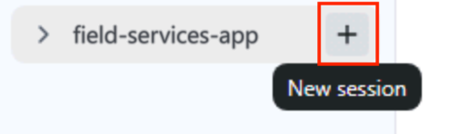
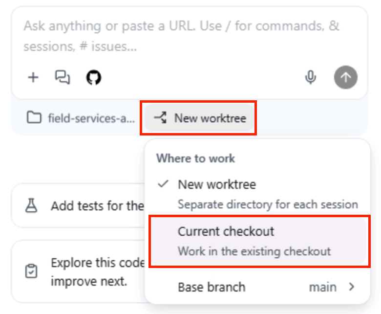
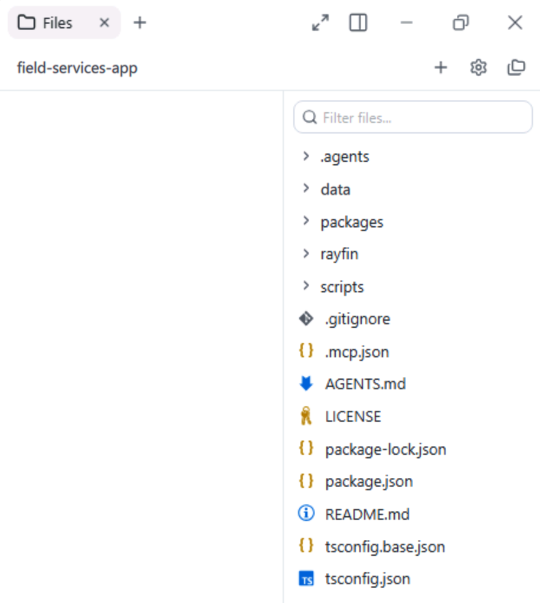

# Exercise 2: Bootstrap the app from a template

In this exercise, ask the GitHub Copilot app to create a Rayfin project from the Field Services template, make an initial Git commit, and open the project.

## Task 1: Create the Rayfin project

1. In the GitHub Copilot app, start a new chat.
2. Enter the following prompt. Replace `<template-path>` with the template path supplied for the lab (`C:/LabFiles/template/field-services-app` in the guided VM, or the full path of `template/field-services-app` in your clone of this repository for self-paced learning). Replace `<workspace-name>` with the exact Fabric workspace display name you recorded in Exercise 1:

    ```text
    Create a new Rayfin app in my user profile folder by running this command:
    npm create -y @microsoft/rayfin@^2.0.0 -- --project-name field-services-app --template "<template-path>" --workspace "<workspace-name>"
    When it's ready, initialize a Git repository in the field-services-app folder and commit all files with the message "Initial commit - bootstrap from template". Then open the folder as a project in the GitHub Copilot app.
    ```

    When Copilot asks for permission to run a command or edit files, review the proposed action, then approve it.

3. Wait for the agent to create the project, record the workspace name, install its dependencies, commit the starter files, and add the **field-services-app** project to the GitHub Copilot app. The create command does not provision the Fabric backend; you will do that with `npx rayfin dev` in Exercise 4.
4. If the template includes a `data/` directory with its app specification or seed data, review it to understand how the starter app was generated.

The initial commit matters: in later exercises, you review each change the agent makes as a clean diff against this starting point.

This lab uses Rayfin `^2.0.0`. The prompts in this lab use `@^2.0.0` in every `npm create` command and `^2.0.0` for Rayfin package additions, and keep SDK and connector dependencies matched to the installed CLI's generated installation guidance. In the generated project, `npx rayfin` runs the installed CLI rather than downloading another CLI version.

## Task 2: Open a session in the project

1. In the left panel of the GitHub Copilot app, hover over the **field-services-app** project and select **+** (**New session**).

    

2. Below the chat input area, select **New worktree** and change it to **Current checkout**.

    

    By default, the GitHub Copilot app creates a new worktree for each session. Rayfin saves deployment details in uncommitted project files, so always work in the current checkout for this lab.

3. Ask Copilot for an overview of the generated project:

    ```text
    Read AGENTS.md and give me a short overview of this project's structure and main folders. Don't change any code.
    ```

4. If a dialog asks whether you trust the repository, select **A. Always trust repository**.
5. In the top-right corner of the app, select the **Toggle panel** button, select **+** (**Open in panel**), then select **Files** to browse the generated files.

    

    To read the code in an editor instead, select **Open in VS Code** in the session header.

Continue to [Explore the app template](03-explore-template.md).
