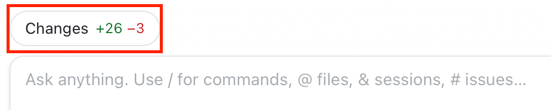

# Exercise 7: Add a feature with GitHub Copilot

In this exercise, use the GitHub Copilot app to add a schema-backed comments feature to work orders. The feature gives service pros and managers a place to discuss job details.

## Task 1: Review the project guidance

1. If the template includes `AGENTS.md`, open it in the **Files** panel of the GitHub Copilot app and review its instructions for the project.
2. In `package.json`, check whether the template includes Rayfin-specific agent or MCP guidance.

## Task 2: Start a GitHub Copilot session

1. In the left panel of the GitHub Copilot app, hover over the **field-services-app** project and select **+** (**New session**).
2. Below the chat input area, make sure that **Current checkout** is selected rather than **New worktree**.

## Task 3: Generate the comments feature

1. Make sure that the development session from Exercise 4 isn't running. If a **Terminal** panel is still running `npx rayfin dev`, select it and press **Ctrl+C**. A running development session can apply schema changes as soon as Copilot edits them; stopping it lets you review backend changes before applying them.
2. In the new session, enter an implementation request such as:

    ```text
    Implement a comments feature for work orders. Comments should provide a history of interventions so service pros and the manager can communicate about a work order. Each comment must include an id, userId, createdAt, workOrderId, and content. Keep the comments section collapsed by default. Let the attendee add comments from the assigned service-pro experience and reply from the manager experience using the same signed-in account. These are switchable demonstration views, not independently authorized roles. Preserve authenticated backend access; do not treat the view switch as authorization or add a second account requirement. Generate the code, but do not apply the backend schema change yet.

    Use ^2.0.0 for Rayfin package additions and @^2.0.0 in every npm create command, rather than latest or prerelease tags. Use the project's installed CLI and keep participating Rayfin packages version-matched.

    Preserve the existing RayfinClient.create composition with browserSession and dataService. Select every field the comments UI needs, convert wire dates at the service boundary, and do not treat partial mutation responses as complete records.
    ```

3. Wait for Copilot to finish. When it asks for permission to edit files or run commands, review each proposed action, then approve it.
4. Review the generated changes. Look for:

    - A new comment entity registered in the Rayfin schema.
    - Authenticated backend access, with comments available in both demonstration workflows.
    - Typed data access to read and create comments.
    - A comments section in the work-order UI that is collapsed by default.

The lab deliberately allows one account to try both views. In production, roles would be assigned to authenticated identities and enforced server-side rather than selected by the user.

## Task 4: Review the changes

Before updating the backend, select the **Changes** button above the chat input area and inspect the changed files. Confirm that the implementation uses the project's Rayfin schema, permission, and typed-client patterns rather than adding an unrelated endpoint or migration mechanism.



## Task 5: Apply the schema and redeploy

After reviewing the implementation, ask Copilot to apply the schema and publish the app in one deployment:

1. In the same session, enter the following prompt:

    ```text
    Apply the reviewed changes to this app's existing Fabric deployment with npx rayfin up. This command applies pending schema changes and publishes the frontend, so do not run a separate database apply command. Do not drop or rename existing tables or columns, reset data, or force destructive changes. If a destructive change is reported, stop and show me the details. Confirm that deployment succeeds and report any errors.
    ```

    If you needed the `RAYFIN_ENCRYPTION_FALLBACK_ENABLED` setting in Exercise 4, include it in this prompt and the next ones too.

2. Confirm that deployment completes successfully and creates the comments table, such as **WorkOrderComments**.

## Task 6: Validate the comments workflow

1. In the same session, ask Copilot to start the local app in a visible terminal, replacing `<workspace-name>` with the display name you recorded in Exercise 1:

    ```text
    Open a terminal in the canvas view so I can watch its output. In that terminal, start the Rayfin development session by running:
    npx rayfin dev --workspace "<workspace-name>"
    Leave it running, and give me the local frontend URL when it's ready.
    ```

2. Open the local app at the URL reported by the agent, then open a work order assigned to your service-pro profile and add a comment.
3. Select **Manager** and confirm you can see and reply to the thread using the same signed-in account.
4. Select **Jobs** and confirm the reply appears. Reload the page and reopen the collapsed comments section to confirm persistence.
5. If time permits, repeat a quick check using the hosted app.
6. *(Optional)* Add comments to several work orders for richer analysis in Exercise 8.
7. Stop the development session by selecting its **Terminal** panel and pressing **Ctrl+C**.

If the feature does not behave as expected, give Copilot the observed behavior or error in the same session and ask for a targeted fix. Review the proposed changes, then repeat the relevant deployment and workflow checks.

Continue to [Add a semantic-model dashboard to the app](08-fabric-insights.md).
